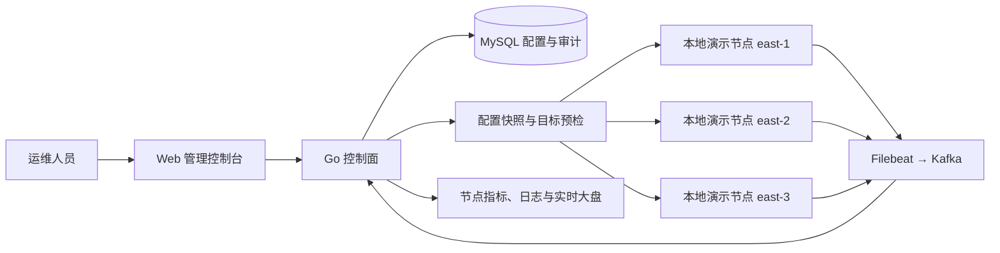

# OpenResty Pilot

**让 OpenResty 集群配置、发布与运行状态更清晰。**

OpenResty Pilot 是面向多中心 OpenResty / NGINX 集群的开源管理平台。它将 Web 管理控制台与 Go 控制面组合为一个服务，用于管理网关资源、查看节点和流量状态，并为配置变更提供预检、差异审查和发布操作。

  

<em>控制台大盘：集中查看请求、带宽、延迟和节点运行状态</em>

## 从配置到运行状态

保存配置和节点实际加载配置是不同状态。发布流程会审查配置差异并运行目标校验；运行结果由节点状态与版本探针确认。

## 你可以做什么

- **管理多中心资源**：维护中心、OpenResty 节点、HTTP / Stream 服务、上游、TLS 证书、DNS Resolver 和 IP 组。
- **管理访问与权限**：使用账号、角色、中心范围权限和审计记录约束日常操作。
- **检查配置变更**：查看语义差异和最终配置文本，执行目标节点配置预检。
- **发布并观察节点**：在本地 Compose 演示环境进行分批发布、观察、中止和单节点历史版本回滚。
- **查看运行情况**：聚合节点指标、健康状态、HTTP 流量、日志和实时大盘；导入获授权的 GeoIP 数据库后可展示来源地理信息。

  

<em>配置审查：在发布前查看差异、校验和发布状态</em>

## 当前能力边界

当前可运行的发布闭环针对 **三个固定的本地 Docker Compose 演示节点**。它验证了渲染、目标节点 `nginx -t`、配置切换、reload、工作进程版本探针、分批观察和单节点回滚。

这不等于通用生产发布通道。生产节点接入、Agent 制品传输与发布编排、异步候选校验工作流、完整运行时 API 响应契约，以及生产日志容量和高可用验收仍在建设或需要按部署环境验证。部分高级 NGINX 指令尚未建模，会在预检时拒绝。未导入合法 GeoIP 数据库时，来源地理信息不可用。

## 开始体验

- [主项目：安装、构建与运行说明](https://github.com/OpenrestyPilot/openresty-pilot)
- [本地演示环境：数据库、Kafka 与 Compose 节点](https://github.com/OpenrestyPilot/orp-quickstart)
- [组织中的其他项目](https://github.com/orgs/OpenrestyPilot/repositories)

源码构建、Docker 镜像和本地演示环境各有依赖与配置步骤，请先阅读对应仓库 README。请勿将演示环境的主机网络或 Docker Socket 配置直接视为生产部署方案。

## 参与贡献

欢迎通过 Issue 报告问题、讨论需求，也欢迎提交 Pull Request。请在改动说明中写明受影响的功能、验证方式和已知边界；提交前请阅读目标仓库的贡献说明。

## 许可证

各项目许可证可能不同，请以对应仓库中的 `LICENSE` 文件为准。
